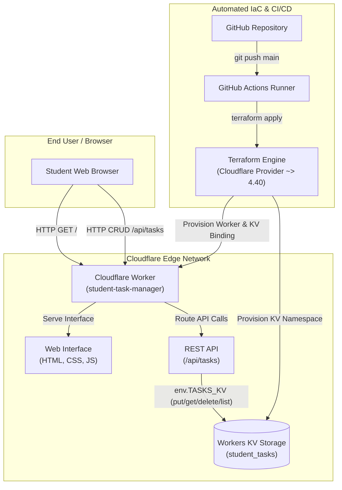

# Automated Deployment of a Serverless Student Task Management Application Using Terraform-Based Infrastructure as Code

[](https://github.com/muditk-dev/student-task-manager-iac/actions/workflows/deploy.yml)
[](https://www.terraform.io/)
[](https://workers.cloudflare.com/)
[](LICENSE)

---

## 1. Problem Statement & IaC Concept

Modern cloud applications require multiple infrastructure components such as compute services, storage, application configuration, environment variables, networking, and deployment settings. Traditionally, these resources are created manually using a cloud provider's graphical web dashboard.

Manual configuration creates major drawbacks:
* **Inconsistent Environments:** Different team members configure settings differently.
* **Human Errors:** Typos, omitted bindings, and misconfigured access rules.
* **Difficult Disaster Recovery:** Rebuilding an environment after failures requires tedious manual reconstruction.
* **No Version Control:** Infrastructure changes cannot be reviewed, tracked, or audited in Git.
* **Slow Turnaround:** Provisioning, updating, and tearing down environments is repetitive and time-consuming.

**Infrastructure as Code (IaC)** solves these problems by representing infrastructure configuration in declarative source-code files. In this project, the entire serverless infrastructure—including the compute runtime (**Cloudflare Workers**), persistent storage (**Cloudflare Workers KV**), environment variables, and storage bindings—is declared and managed using **Terraform**. No resources are created manually through the web dashboard.

---

## 2. Proposed System Architecture



---

## 3. Technologies Used

| Component | Technology | Role / Purpose |
| :--- | :--- | :--- |
| **Infrastructure as Code** | HashiCorp Terraform (v1.16+) | Declarative provisioning of compute, storage, bindings, and variables |
| **Cloud Platform** | Cloudflare (Free Plan) | Globally distributed edge execution network |
| **Compute Engine** | Cloudflare Workers (V8 Isolates) | Serverless execution serving REST API and Web Interface |
| **Persistent Storage** | Cloudflare Workers KV | Low-latency globally replicated Key-Value database |
| **Frontend Interface** | HTML5, CSS3, Modern JavaScript | Responsive academic task dashboard with live stats and filtering |
| **API Architecture** | RESTful JSON API | CRUD operations (`GET`, `POST`, `PUT`, `DELETE`, `OPTIONS`) |
| **Version Control** | Git | Semantic change tracking and commit history |
| **Code Repository** | GitHub | Central version-controlled repository |
| **CI/CD Automation** | GitHub Actions | Automated validation, plan, and deployment pipeline |

---

## 4. Repository Structure

```
student-task-manager-iac/
├── .github/
│   └── workflows/
│       └── deploy.yml              # Automated GitHub Actions CI/CD pipeline
├── application/
│   ├── index.html                  # Responsive academic task dashboard interface
│   ├── style.css                   # Custom responsive styling and theme variables
│   ├── script.js                   # Client-side API controller, metrics, and filters
│   └── worker.js                   # Cloudflare Worker code (REST API & static server)
├── screenshots/
│   └── README.md                   # Checklist and instructions for project evaluation
├── terraform/
│   ├── main.tf                     # Cloudflare Worker & KV namespace resource declarations
│   ├── variables.tf                # Variable definitions (Account ID, Worker Name, etc.)
│   ├── outputs.tf                  # Outputs (Worker name, KV Namespace ID, App URL)
│   ├── providers.tf                # Provider requirements (cloudflare/cloudflare ~> 4.40)
│   └── terraform.tfvars.example    # Variable input template for local deployment
├── test/
│   └── run-tests.js                # In-memory test suite for Worker REST API & KV CRUD
├── .gitignore                      # Excludes credentials, state files, and node_modules
├── build.js                        # Build script synchronizing static assets into worker.js
├── package.json                    # Node.js project manifest and test runner scripts
└── README.md                       # Complete project documentation and report guide
```

---

## 5. Functional Requirements & REST API

The application provides complete academic task management as specified in the scenario:

### Academic Task Data Model
Each task record maintains:
* `id` (`string`): Unique academic task ID (e.g., `T101`, `T102`).
* `title` (`string`): Academic title (e.g., `Complete Cloud Computing Assignment`).
* `priority` (`string`): Task priority (`High`, `Medium`, `Low`).
* `status` (`string`): Current status (`Pending`, `In Progress`, `Completed`).
* `category` (`string`): Academic category (`Assignment`, `Project`, `Laboratory`, `Viva`, `General`).
* `deadline` (`string` | `null`): Optional due date.
* `createdAt` (`string`): ISO timestamp.
* `updatedAt` (`string`): ISO timestamp.

### REST API Endpoints

| Method | Endpoint | Description | Status Code | Example Payload / Notes |
| :--- | :--- | :--- | :--- | :--- |
| **GET** | `/api/tasks` | Retrieve all academic tasks | `200 OK` | Returns JSON array of tasks |
| **GET** | `/api/tasks/{id}` | Retrieve individual task by ID | `200 OK` / `404 Not Found` | Returns single task object |
| **POST** | `/api/tasks` | Create new academic task | `201 Created` | `{"title":"Submit Project Report","priority":"High","status":"Pending"}` |
| **PUT** | `/api/tasks/{id}` | Update existing task or change status | `200 OK` / `404 Not Found` | `{"status":"Completed"}` |
| **DELETE** | `/api/tasks/{id}` | Delete task from Workers KV | `200 OK` / `404 Not Found` | `{"message":"Task removed successfully.","id":"T101"}` |
| **GET** | `/api/info` | Diagnostic details & environment | `200 OK` | `{"appName":"Student Task Manager","kvBound":true}` |
| **OPTIONS** | `*` | CORS Preflight handling | `204 No Content` | Allows cross-origin REST requests |

---

## 6. Step-by-Step Implementation Guide

### Prerequisites
* [Terraform v1.5+](https://developer.hashicorp.com/terraform/install)
* [Node.js v18+](https://nodejs.org/)
* [Git](https://git-scm.com/)
* [Cloudflare Account](https://dash.cloudflare.com/) (Free plan)

---

### Step 1: Cloudflare Credentials Setup
1. Log in to the [Cloudflare Dashboard](https://dash.cloudflare.com/).
2. Locate your **Account ID** in the right-hand sidebar.
3. Navigate to **My Profile > API Tokens > Create Token**.
4. Select **Create Custom Token** and configure the following permissions:
   * `Account | Workers Scripts | Edit`
   * `Account | Workers KV Storage | Edit`
5. Save the generated API token securely.

---

### Step 2: Local Application & Test Verification
Run the automated test suite locally to verify worker logic, REST API endpoints, KV storage mock, and static asset serving:

```bash
# Run test suite
npm test
```

Expected output:
```
====================================================
🧪 Starting Student Task Manager Test Suite
====================================================
▶ Test 1: Verifying frontend files exist and are readable...
  ✓ All frontend and worker files verified on disk.
▶ Test 2: Testing Static Web Interface Serving (HTML, CSS, JS)...
  ✓ HTML, CSS, and JS served with correct Content-Type headers.
▶ Test 3: Testing /api/info diagnostics...
  ✓ /api/info verified.
▶ Test 4: Testing FR1 / POST /api/tasks (Create Task - PDF Test Case 1)...
  ✓ Task successfully created with ID: T101
▶ Test 5: Testing FR2 / GET /api/tasks and GET /api/tasks/{id} (PDF Test Case 2)...
  ✓ Previously created task successfully displayed and retrieved.
▶ Test 6: Testing FR3 / PUT /api/tasks/{id} (Update Task - PDF Test Case 3)...
  ✓ Status changed successfully to "Completed".
▶ Test 7: Testing FR4 / DELETE /api/tasks/{id} (Delete Task - PDF Test Case 4)...
  ✓ Task removed successfully and confirmed 404 on subsequent get.
▶ Test 8: Testing Input Validation...
  ✓ Validation and 404 error responses confirmed.
▶ Test 9: Testing CORS preflight and headers...
  ✓ CORS preflight headers verified.
====================================================
🎉 ALL APPLICATION AND API TESTS PASSED SUCCESSFULLY
====================================================
```

---

### Step 3: Terraform Infrastructure Lifecycle

Navigate to the `terraform/` directory:
```bash
cd terraform
```

#### 1. Initialize Terraform (`terraform init`)
Downloads the official Cloudflare provider plugin (`~> 4.40`) and configures backend state:
```bash
terraform init
```
*Expected Result:* `Terraform has been successfully initialized!`

#### 2. Format Configuration (`terraform fmt`)
Ensures all `.tf` files adhere to canonical Terraform syntax:
```bash
terraform fmt
```

#### 3. Validate Configuration (`terraform validate`)
Performs static analysis of variables, syntax, and resource definitions:
```bash
terraform validate
```
*Expected Result:* `Success! The configuration is valid.`

#### 4. Configure Variables
Create your `terraform.tfvars` file (this file is excluded from Git by `.gitignore`):
```bash
cp terraform.tfvars.example terraform.tfvars
```
Fill in your actual Cloudflare credentials:
```hcl
cloudflare_api_token = "YOUR_CLOUDFLARE_API_TOKEN"
account_id           = "YOUR_CLOUDFLARE_ACCOUNT_ID"
worker_name          = "student-task-manager"
kv_namespace_name    = "student_tasks"
environment          = "production"
app_title            = "Student Task Manager"
```

#### 5. Generate Execution Plan (`terraform plan`)
Previews all infrastructure changes without applying them:
```bash
terraform plan
```
*Expected Output:*
```
Plan: 2 to add, 0 to change, 0 to destroy.

Changes to Outputs:
  + application_url    = "https://student-task-manager.workers.dev"
  + environment        = "production"
  + kv_namespace_id    = (known after apply)
  + kv_namespace_title = "student_tasks"
  + worker_name        = "student-task-manager"
```

#### 6. Provision Infrastructure (`terraform apply`)
Applies the plan to create the Cloudflare Worker and KV Namespace:
```bash
terraform apply
```
Type `yes` when prompted.
*Expected Result:* `Apply complete! Resources: 2 added, 0 changed, 0 destroyed.`

#### 7. Inspect Terraform State (`terraform show`)
Displays all live resources tracked in `terraform.tfstate`:
```bash
terraform show
```

---

### Step 4: Verification & Application Testing

1. Open the deployed application URL in your web browser:
   ```
   https://student-task-manager.workers.dev
   ```
2. **Execute Mandatory Demonstration Test Cases:**
   * **Test Case 1 (Create Task):** Enter title `Prepare Final Year Project Presentation`, Priority `High`, Status `Pending`. Click **Create Task**. Verify task appears with ID `T101`.
   * **Test Case 2 (Read Task):** Refresh browser or click **Refresh**. Verify `T101` is fetched from Cloudflare Workers KV.
   * **Test Case 3 (Update Task):** Click the status toggle or edit button and change status from `Pending` to `Completed`. Verify the badge turns green and completion stats update.
   * **Test Case 4 (Delete Task):** Click **Delete**. Confirm removal and verify the task is deleted from KV.

---

### Step 5: Infrastructure Modification Experiment

As required by Step 21 of the specification:
1. Open `terraform/variables.tf` or `terraform/terraform.tfvars`.
2. Change the application title or environment:
   ```hcl
   app_title   = "Cloud-Based Student Task Manager"
   environment = "staging"
   ```
3. Run `terraform plan`:
   Notice Terraform calculates the exact in-place modification (`~ modify`) without destroying the KV namespace!
4. Run `terraform apply -auto-approve`:
   Verify the updated configuration is applied instantly at Cloudflare edge.

---

### Step 6: Infrastructure Destruction & Reproducible Recreation

Demonstrating complete IaC lifecycle management:

#### 1. Destroy Infrastructure (`terraform destroy`)
```bash
terraform plan -destroy
terraform destroy
```
Type `yes` to confirm.
*Expected Result:* `Destroy complete! Resources: 2 destroyed.`
*Verification:* Inspect the Cloudflare dashboard; both the Worker and KV namespace are completely removed.

#### 2. Recreate Infrastructure Automatically
```bash
terraform plan
terraform apply -auto-approve
```
*Result:* Without any manual dashboard clicks, Terraform provisions the complete serverless architecture from scratch within seconds!

---

## 7. CI/CD with GitHub Actions

The repository includes `.github/workflows/deploy.yml` for automated continuous deployment.

### Setup GitHub Secrets:
1. Open your GitHub Repository.
2. Navigate to **Settings > Secrets and variables > Actions > New repository secret**.
3. Add the following repository secrets:
   * `CLOUDFLARE_API_TOKEN`: Your Cloudflare API token.
   * `CLOUDFLARE_ACCOUNT_ID`: Your Cloudflare account ID.

### Automated Trigger:
Whenever changes are pushed to `main` (or when triggered via GitHub `workflow_dispatch`), the CI/CD pipeline automatically:
1. Checks out repository source code.
2. Installs Node.js and executes `npm test`.
3. Installs HashiCorp Terraform.
4. Executes `terraform fmt -check`.
5. Executes `terraform init`.
6. Executes `terraform validate`.
7. Executes `terraform plan`.
8. Executes `terraform apply -auto-approve`.

---

## 8. Questions & Answers for Viva / Mini Project Report

Below are comprehensive answers to the 20 mandatory theoretical and practical questions specified in Section 38 of the project guidelines:

### Q1: What is Infrastructure as Code (IaC)?
**Answer:** Infrastructure as Code (IaC) is the practice of defining, provisioning, and managing computing infrastructure (such as servers, storage, serverless functions, and networking) using machine-readable configuration files rather than manual processes or web dashboards.

### Q2: What problem does IaC solve?
**Answer:** IaC eliminates human error during manual setup, resolves environment inconsistencies (configuration drift), enables version controlling and peer review of infrastructure, speeds up deployment pipelines, and makes disaster recovery and infrastructure recreation completely reproducible and automated.

### Q3: Why is Terraform called a declarative IaC tool?
**Answer:** Terraform is declarative because you specify **what** the desired end state of your infrastructure should look like (e.g., "create a Worker script with a KV binding"), and Terraform's engine calculates the dependency graph and steps needed to achieve that state. This contrasts with imperative tools where you specify step-by-step commands on *how* to build it.

### Q4: What is a Terraform provider?
**Answer:** A Terraform provider is a plugin that understands API interactions with a specific cloud platform or service (such as Cloudflare, AWS, or Azure). It translates declarative Terraform resource blocks into real HTTP REST API calls to the target platform.

### Q5: What is a Terraform resource?
**Answer:** A resource block declares an infrastructure object that Terraform will manage over its lifecycle. Examples in this project include `cloudflare_workers_kv_namespace` (KV storage) and `cloudflare_workers_script` (the serverless compute script).

### Q6: What is a Terraform variable?
**Answer:** A variable parameterizes Terraform configurations, allowing values such as Account IDs, resource names, or environments to be passed dynamically without hardcoding values into the configuration files.

### Q7: What is a Terraform output?
**Answer:** An output exports values from the provisioned infrastructure (such as the generated KV Namespace ID, Worker script name, or application URL) so they can be viewed on the command line or consumed by other automation tools.

### Q8: What is Terraform state?
**Answer:** Terraform state (`terraform.tfstate`) is a JSON file that records the mapping between resources declared in your configuration files and the real-world resource IDs created in the cloud provider. It tracks metadata, resource dependencies, and configuration attributes.

### Q9: What happens during `terraform init`?
**Answer:** `terraform init` initializes the working directory, downloads and configures the required provider plugins (e.g., `cloudflare/cloudflare`), sets up the backend storage for state, and creates the dependency lock file (`.terraform.lock.hcl`).

### Q10: What happens during `terraform plan`?
**Answer:** `terraform plan` reads the current state, queries the cloud provider's real infrastructure, compares it against the desired configuration in `.tf` files, and generates an execution plan showing what will be added (`+`), modified (`~`), or destroyed (`-`).

### Q11: What happens during `terraform apply`?
**Answer:** `terraform apply` executes the actions proposed in the execution plan by calling the provider APIs, provisions or updates the infrastructure, and updates the local state file with the newly created resource identifiers.

### Q12: What happens during `terraform destroy`?
**Answer:** `terraform destroy` reads the state file and deletes all resources managed by the current Terraform configuration in reverse dependency order, ensuring no orphaned cloud resources remain.

### Q13: Why should infrastructure not be modified manually after Terraform manages it?
**Answer:** Modifying resources directly via the cloud provider's web dashboard introduces **infrastructure drift**. When Terraform runs next, it will detect the discrepancy between the real state and the declared state, which may lead to unintentional overwrites, errors, or unexpected resource replacements.

### Q14: Why should API tokens not be stored in Terraform source code?
**Answer:** Hardcoded API tokens committed to version control repositories (especially public GitHub repositories) can be scraped by automated bots, compromising cloud accounts, leaking private data, and incurring unauthorized usage charges.

### Q15: What is a KV database?
**Answer:** A Key-Value (KV) database is a NoSQL storage system where data is stored as a collection of unique keys mapped to corresponding data values. Cloudflare Workers KV is a globally distributed, highly read-optimized key-value store replicated across Cloudflare's edge data centers.

### Q16: Why was serverless computing selected for this project?
**Answer:** Serverless computing eliminates the need to manage virtual machines or operating systems. Cloudflare Workers execute instantly at edge locations worldwide with zero cold starts, auto-scale from zero to high traffic, and provide a generous Free Tier (100,000 requests/day), minimizing operational complexity and cost.

### Q17: What is CI/CD?
**Answer:** CI/CD stands for Continuous Integration and Continuous Deployment/Delivery. CI automatically builds and tests code when changes are pushed; CD automatically deploys validated code and infrastructure updates directly to staging or production environments.

### Q18: What role does GitHub Actions perform?
**Answer:** GitHub Actions acts as the CI/CD automation runner. Upon every `git push`, it runs tests, validates Terraform syntax, generates an execution plan, and executes `terraform apply` using credentials stored securely in GitHub Secrets.

### Q19: How can Terraform recreate infrastructure after deletion?
**Answer:** Because the complete specification of compute, storage, bindings, and environment variables is preserved in declarative `.tf` configuration files, running `terraform apply` instructs the provider to recreate all identical resources from scratch.

### Q20: What is infrastructure drift?
**Answer:** Infrastructure drift occurs when the actual configuration of cloud resources diverges from the state defined in the IaC configuration files, typically caused by manual dashboard adjustments, out-of-band scripts, or emergency hotfixes.

---

## 9. License

This project is licensed under the MIT License - see the [LICENSE](LICENSE) file for details.
